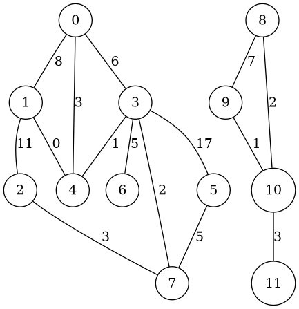
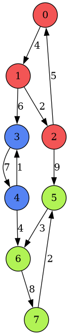
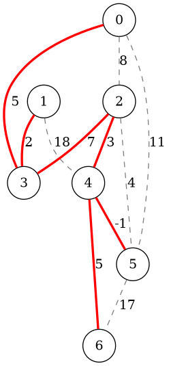
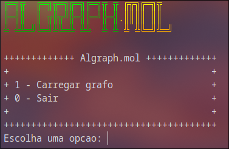
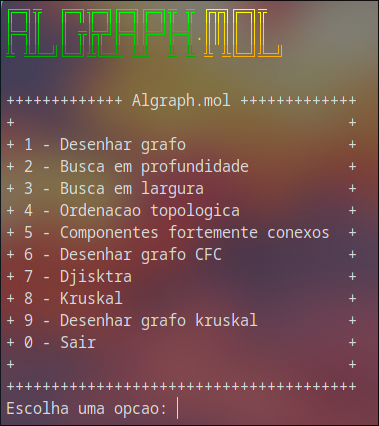

# Implementação de algoritmos em grafo

**Disciplina:** Projeto e Análise de Algoritmos.

**Professor:** Newton Spolaor.

**Estudante:** [Marcos Sousa](https://github.com/molsousa).

## Descrição

Este repositório contém seis algoritmos em grafo implementados em C++ para a disciplina de Projeto e Análise de Algoritmos.

## Estrutura

O grafo foi implementado utilizando matriz de adjacência, adaptado do Pascal no material de [Nivio Ziviani em Projeto de Algoritmos: com implementação em Pascal e C](#referências).

```cpp  
class grafo
{
private:
    tipoPeso mat[MAX_NUM_VERTICES][MAX_NUM_VERTICES];
    int num_vertices;
    int num_arestas;
    tipoGrafo tipo;
...
};
``` 

Fora implementado manualmente estruturas de dados como pilha, fila, fila de prioridade e union find, todos esses presentes na pasta '[estrutura_dados](src/estrutura_dados)'.

Em '[utils](include/utils.hpp)' contém definições que serão utilizados durante toda a implementação, além de um arquivo de [teste](teste.cpp) na raiz principal do projeto.

## Os algoritmos

São no total seis algoritmos implementados, sendo eles:

- [Busca em profundidade (DFS)](#busca-em-profundidade-dfs).
- [Busca em largura (BFS)](#busca-em-largura-bfs).
- [Ordenação topológica](#ordenação-topológica).
- [Componentes fortemente conexos](#componentes-fortemente-conexos).
- [Dijkstra](#dijkstra).
- [AGM Kruskal](#agm-kruskal).

### Busca em profundidade (DFS)

Foi utilizado pilha apenas para guardar os vértices pais, o restante do algoritmo foi reutilizando as funções de grafo já implementadas, como primeiro_lista_adjacencia e prox_adjacencia que buscam o primeiro vértice da lista de adjacência a partir de um vértice referência e buscam o próximo vértice em adjacência com o vértice de referência respectivamente. 

O algoritmo marca todos os vértices com branco antes da sua execução, marca cinza quando um vértice foi visitado e preto quando finaliza a busca no determinado vértice. A função-membro tem estrutura recursiva, sendo o ponto de parada quando não houver mais vértices brancos. 

O algoritmo inicializa a partir do vértice de menor rótulo (no caso o vértice 0).

### Busca em largura (BFS)

Foi utilizado fila para armazenar os vértices a serem visitados quando é acessado o vértice pai. 

Todos os vértices são inicializados em branco, quando é acessado um vértice pai é pintado de cinza e após finalizar é pintado de preto. 

Assim como na implementação do DFS, fora utilizado funções-membro da classe do grafo para a implementação do algoritmo, para esse algoritmo também é usado um vetor de distância para demarcar a profundidade do grafo conforme desce o nível. 

O algoritmo inicializa a partir do vértice de menor rótulo (no caso o vértice 0).

### Ordenação topológica 

O algoritmo DFS foi adaptado para ordenação topológica, caso forme ciclo, a ordenação topológica não é finalizada. 

Para a implementação é utilizada a estrutura de pilha para empilhar os vértices ordenados. 

O último vértice a finalizar o DFS é o primeiro vértice na lista encadeada.

### Componentes fortemente conexos 

Utiliza o DFS implementado para ordenação topológica para encontrar a ordem de fechamento de cada vértice, após é criado um grafo transposto (utilizando uma função-membro da classe grafo). 

E, com esse grafo é executado outro DFS sobre o grafo transposto com o vértice de referência sendo os vértices ordenados do primeiro grafo, se forem brancos e não tiverem adjacência com outros vértices, volta da recursão e são considerados de outro componente, e assim segue o fluxo de execução.

### Dijkstra 

O algoritmo não admite arestas negativas, ignorando a sua presença. 

Utiliza dois vetores, de distância e outro de pai sendo inicializado com INFINITO e -1 respectivamente. 

Utiliza fila de prioridade para acessar o melhor caminho no momento. 

Caso o algoritmo “perceba” que o custo está aumentando, escolhe outro melhor caminho a se seguir. 

Conforme o algoritmo vai escolhendo os caminhos, o custo vai aumentando conforme o peso da aresta.

### AGM Kruskal 

Algoritmo da árvore geradora mínima, Kruskal, para a implementação foi utilizado a estrutura de aresta o algoritmo percorre o vetor de arestas para encontrar as arestas de menor valor que possa gerar uma árvore, permitindo um custo mínimo para percorrer todos os vértices. 

Na implementação é permitido valores negativos de pesos de arestas.

## Desenho dos grafos

Para esse trabalho, fora solicitado que incluísse geração dos grafos.

Os grafos foram gerados usando o software externo: '[*graphviz*](#referências)'

São três tipos de geração de grafo: o grafo gerado normalmente, o grafo com os componentes fortemente conexos e as arestas após gerar AGM Kruskal.

Após gerar o arquivo-fonte, deve executar no mesmo local onde foi gerado o arquivo.

```sh
dot -Tpng arq.dot -o arq.png
```

Segue abaixo três grafos diferentes com as suas respectivas gerações:

### Grafo comum:



### Grafo com os componentes fortemente conexos 



### Grafo com as arestas AGM Kruskal




## Compilação e execução 

Usando Makefile:

```sh 
make
./algraph.mol
```

Compilação manual:

```sh
g++ main.cpp src/*.cpp src/estrutura_dados/*.cpp
./a.out
```

## Menu de opções 

Foram adicionados duas interfaces de menu de opções, uma para carregar o grafo conforme a sintaxe abaixo e outra interface para escolher o algoritmo ou geração de grafo a ser executado.

### Sintaxe do arquivo

```txt 
orientado=sim/nao 
V=y
(u,v):p
(u,v):p
(u,v):p
...
```

Em 'orientado', o usuário deve escolher 'sim' ou 'nao' para grafo orientado ou não orientado respectivamente.

Em 'V=y', o usuário deve informar o número de vértices do grafo.

Em cada '(u,v):p', o usuário deve informar o vértice de origem (u), o vértice destino (v) e o peso correspondente da aresta (p), podendo ser positivo, negativo, zero e aceitando ponto flutuante.

O arquivo de texto que contém o grafo na sintaxe acima deve ser adicionado na pasta raiz do executável.

### Menu para carregar grafo



### Menu para seleção de algoritmo 



## Referências

GRAPHVIZ. **Graphviz**. [S. l.]: Graphviz, [2026]. Disponível em: https://graphviz.org/. Acesso em: 27 out. 2026.

ZIVIANI, Nivio. **Projeto de algoritmos: com implementações em Pascal e C**. 3. ed. São Paulo: Cengage Learning, 2011. 639 p.

CORMEN, Thomas H.; LEISERSON, Charles E.; RIVEST, Ronald L.; STEIN, Clifford. **Introduction to algorithms**. 3rd ed. Cambridge, MA: MIT Press, 2009. Disponível em: https://www.cs.mcgill.ca/~akroit/math/compsci/Cormen%20Introduction%20to%20Algorithms.pdf. Acesso em: 27 out. 2026.

---
